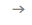

<h1>研究成果</h1>

<h2>研究成果</h2>
<a href="https://www.aist.go.jp/aist_j/list/l_research_research.html?txtSearch=search&amp;psAttributenameid14=16&amp;psAttributeitemid14=&amp;psFreeWord14=&amp;Selldatetime_Start14=&amp;Selldatetime_End14=&amp;Selldatetime_Order14=0&amp;search14=1" target="_blank">情報・人間工学領域の研究成果のご紹介</a>  
 
<a href="https://www.aist.go.jp/aist_j/researcher/aboutus/howto04.html" target="_blank">産総研の研究成果のご紹介</a>  
 
 
<!--
      <h2>論文発表</h2>
      
      <a href="https://rise.db.aist.go.jp/il/meta_pub/G0000380REPO" target="_blank">産総研論文検索システム</a> で論文検索することができます。  --> 
 
 
<h2>プレスリリース・ニュース</h2>
 
<table class="listTable">
<tbody>
<tr>
<th width="20%">発表日</th>
<th>タイトル</th>
</tr>
<tr>
<td>2025年9月2日</td>
<td><b>双腕ロボットAIの開発を支援するデータセットを無償公開</b> 
            　－両手を使うロボットAI開発の足がかりを提供－（<a href="https://www.aist.go.jp/aist_j/press_release/pr2025/pr20250902/pr20250902.html" target="_blank">紹介記事</a>） 
 
            関係ユニット： 
<ul>
<li><a href="https://www.airc.aist.go.jp/" target="_blank">人工知能研究センター</a></li>
<li><a href="{{ '/' | relative_url }}" target="_blank">インテリジェントシステム研究部門</a> 
              　<a href="{{ '/isri-jrl/jp/' | relative_url }}" target="_blank">CNRS-産総研ロボット工学連携研究室（JRL）</a></li>
</ul>
</td>
</tr>
</tbody>
</table>
 
 

